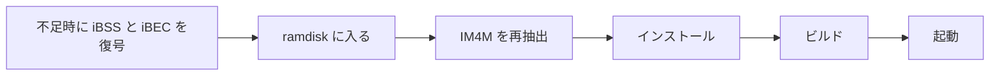

<div align="center">

# n56-patcher

**iPhone 6（N61AP / iPhone7,2）で iOS 13.7 をセカンドシステムとして動かすためのビルド・インストールツール**

[简体中文](README.md) · [English](README.en.md) · [繁體中文](README.zh-TW.md) · 日本語


-5E5CE6?style=flat-square)


[クイックスタート](#クイックスタート) · [機能](#機能) · [高度な使い方](#高度な使い方) · [作者](#作者) · [プロジェクトの支援](#プロジェクトの支援)

<sub>同じ手順は iPhone 6 Plus（N56AP / iPhone7,1）にも使えます。`--target n56-ios13` で切り替えます。</sub>

</div>

---

デフォルトでは、クリーンな J96 カーネルから KC を再構築し、iBSS、iBEC、DeviceTree、TrustCache も生成します（ブートイメージは計 5 つ）。カーネルと DeviceTree の変換は本リポジトリの `patches/impl/` を直接呼び出し、ファームウェアの入力はローカルの `donors/` に置きます。

プロジェクトは最初から最後まで動作を確認済みで、最終的なブートパッケージにはハードウェア対応、DataB の復号、checkra1n が含まれます。技術的な結論は [docs/conclusions.md](docs/conclusions.md)、iPhone 6 の移植記録は [docs/n61-porting.md](docs/n61-porting.md)（いずれも中国語）を参照してください。

> [!WARNING]
> このツールはデバイス上にボリュームを作成し、システムを書き込みます。事前にバックアップを取ってください。本プロジェクトは Apple とは無関係で、現状のまま提供されます。使用に伴うリスクは利用者が負うものとします。

## クイックスタート

### 1. 環境の準備

macOS に完全版の Xcode（iPhoneOS SDK が必要）をインストールしてから実行します：

```sh
python3 -m pip install -r requirements.txt
python3 tools/setup.py
```

`tools/setup.py` は `donors/`（checkra1n のユーザーランドと iOS 14 の fsck、apfs.fs）を生成し、gaster をソースからビルドします。初回ビルドでは iBSS と iBEC を復号するため、デバイスを DFU にしておく必要があります。

SSH ramdisk は DFU 状態で一度だけ生成します（インターネット接続が必要）：

```sh
cd tools/SSHRD_Script && ./sshrd.sh 12.5.8
```

### 2. IPSW のダウンロード

以下のファイルを Apple からダウンロードし、ファイル名を変えずに `ipsw/` に置きます：

```text
ipsw/iPhone_4.7_12.5.8_16H88_Restore.ipsw          # N61 実機の 12.5.8：iBSS/iBEC/カーネル/DeviceTree/無線ファーム
ipsw/iPhone_5.5_13.7_17H35_Restore.ipsw            # N66：13.7 カーネルのベース
ipsw/iPhone_4.7_13.7_17H35_Restore.ipsw            # N71：4.7" の UI リソース（ui_donor）
ipsw/iPad_64bit_TouchID_13.7_17H35_Restore.ipsw    # J96：クリーンな KC と TrustCache
```

初めて rootfs が必要になったときに DMG を `ipsw/cache/` へ展開し、以降はそれを再利用します。

### 3. エンドツーエンドフローの実行

初回実行時や復元後は、デバイスを DFU にしてからエンドツーエンドフローを実行するか、Web UI で「端到端」（エンドツーエンド）を選択します：

```sh
sudo python3 n56patcher.py all
# ローカル Web UI。ディスクへ書き込むステージには sudo が必要です：
sudo python3 gui.py
```



> [!IMPORTANT]
> - 復元すると古い IM4M とブートパッケージは無効になります。`build` は `state/IM4M.bin` の存在だけを確認し、古いかどうかは判定しないため、単独でビルドする前に `extract-im4m` を実行してください。
> - Web UI の各ステージは個別の `build/` ディレクトリを使うため、ステージごとに実行すると `boot` は `build` の結果を再利用しません。新規インストールには「端到端」（エンドツーエンド）を使ってください。
> - `--dry-run` はフローを表示するだけで、デバイスへのアクセスや書き込みを行わず、ビルド成果物も生成しません。
> - Web UI は简体中文、English、繁體中文、日本語に対応し、上部バーで切り替えられます。コンソールのログは CLI の出力で、中国語のままです。

### ローカルディレクトリ

以下のディレクトリは Git の無視ルールに追加済みです：

| ディレクトリ | 内容 |
| --- | --- |
| `ipsw/` | 自分でダウンロードした IPSW。カーネル、DeviceTree、TC、Wi-Fi ファームウェア、Health ライブラリはビルド時に `ipsw/cache/derived/` へ自動生成されます |
| `donors/` | `tools/setup.py` が生成するファームウェア入力 |
| `state/` | IM4M。`--data-protection none` には `state/keybags.tar` を別途用意する必要がありますが、デフォルトの `encrypted` では不要です |
| `build/` | 生成結果 |

## 機能

デフォルトではすべての機能が選択されます。`--features` は機能単位で各レイヤーのパッチを選択し、`--patches` は KC の選択だけを上書きします。依存関係は自動で補完されます。

| 機能 | KC patch ID | 自動で含まれるもの |
| --- | --- | --- |
| `pmu` | `kc.pmu_d2186` | ベース KC |
| `touch` | `kc.mt_n56` | PMU、Chestnut |
| `charging` | `kc.sn2400` | PMU |
| `chestnut` | `kc.chestnut_kext` | ベース KC |
| `wifi` | `kc.wifi` | ベース KC |
| `vibration` | `kc.vibration` | ベース KC |
| `sep` | `kc.legacy_sep` | ベース KC |
| `audio` | `kc.audio` | ベース KC |

## 高度な使い方

<details>
<summary><b>ビルドと起動</b></summary>

```sh
python3 n56patcher.py build --workdir build/current
python3 n56patcher.py boot --workdir build/current
```

ビルドチェーン：

```text
クリーンな J96 KC → 汎用ブートパッチ → D2207 PMU 対応 → SN2400 → Chestnut
                  → N61 タッチ → Wi-Fi → DRV2604 → SEP 互換 → CS42L67
                  → complzss + watchtower → boot_KC.img4
```

DeviceTree は実機の 12.5.8（N61 iOS 12）と N66 iOS 13 の元の JSONC から再構築します。

TrustCache は repair-v7 の完全なセットをベースに、その場で生成した mrm、最終的な Health ライブラリ、Bluetooth/SEP サービス、結合 dyld cache の cdhash を追加します。

Health オーバーレイは、まず N66 17H35 から対象 50 バンドルの非 Mach-O リソースをすべて配置し、次に repair-v7 で修正したバイナリで上書きします。これにより Core Data モデル、plist、素材、ローカライズファイルの完全性を保ちます。

`ui` オーバーレイは UI donor（4.7" は N71、5.5" は N66）の 17H35 から Health、電話、Wallet を配置し、不足または内容の異なる iPhone Settings のリソースと設定バンドルのバイナリをすべて上書きして、起動ロゴ、アプリアイコン、壁紙を補います。donor に `@3x` しかない場合は `@2x` を使います。アプリ本体は 13.7 donor 由来のものだけを受け付けます。

クリーンビルドの KC、iBSS、DeviceTree は実機のブートパッケージとバイト単位で一致します。iBEC は boot-args を内包しており、デフォルトでは `serial=3` を含みません。シリアルログが必要な場合は `--bootargs` で上書きしてください。TrustCache は同じビルドで書き込んだ rootfs と対になるため、インストール済みのデバイスは自身のブートパッケージを使い続けます。詳しくは[技術的な結論](docs/conclusions.md#trustcache-配套)（中国語）を参照してください。

</details>

<details>
<summary><b>Cherry-pick</b></summary>

```sh
# Wi-Fi とオーディオだけを選んだときの実際のパッチ一覧を表示
python3 n56patcher.py list --patches kc.wifi,kc.audio
# この 2 つの KC パッチをビルド
python3 n56patcher.py build --patches kc.wifi,kc.audio --workdir build/wifi-audio
# 機能単位でタッチを選択（PMU と Chestnut は自動で含まれる）
python3 n56patcher.py build --features core,touch --workdir build/touch
# デフォルトの全機能からオーディオを除外
python3 n56patcher.py build --exclude kc.audio --workdir build/no-audio
```

`--patches` は KC を正確に選択し、rootfs は引き続き `--features` の選択に従います。`--patches ''` はベース KC を生成します。GUI では必要な機能にチェックを入れるだけで、実行順序は自動で決まります。

</details>

<details>
<summary><b>セカンドシステムの段階的なインストール</b></summary>

ボリューム構成は `disk0s1s4` が SystemB、`disk0s1s5` が DataB です。

```sh
python3 n56patcher.py ramdisk
python3 n56patcher.py extract-im4m
sudo python3 n56patcher.py install --workdir build/current
python3 n56patcher.py build --workdir build/current
python3 n56patcher.py boot --workdir build/current
```

DataB はデフォルトで暗号化コンテンツ保護が有効で、インストールフローが systembag を自動作成します。Cydia は `checkra1n` 機能とともにインストールされ、ダウンロードにインターネット接続が必要です。初回起動の約 30 秒後に設定が自動で完了します。

インストールフローは、空の Application コンテナセットに対する `installd` の処理も修正し、最初の無料署名アプリをインストールできるようにします。

オーバーレイは SystemA（N61 12.5.8）、UI donor、J96 の rootfs から直接生成します。IPSW が `ipsw/` にない場合は、パスを明示的に渡せます：

```sh
sudo python3 n56patcher.py install \
  --n66-ipsw /path/to/iPhone_5.5_13.7_17H35_Restore.ipsw \
  --j96-ipsw /path/to/iPad_64bit_TouchID_13.7_17H35_Restore.ipsw
```

現在の profile は SystemA 16H88（N61）、N66/N71/J96 17H35 に対応します。フローは build、主要ファイルのダイジェスト、すべてのバイトパッチの元の内容を検証します。

</details>

<details>
<summary><b>ソースの構成</b></summary>

- `targets/`：デバイス、入力パス、機能の選択。
- `patches/kc/`、`patches/dt/`、`patches/rootfs/`：ビルドとインストールの手順。
- `patches/impl/`：カーネル、ドライバ、DeviceTree を実際に変更するソースと ABI マップ。
- `core/`：依存関係の順序付け、パス解決、ツール呼び出し、ramdisk、APFS。
- `tools/`：バージョン固定の上流 submodule、初期化ツール、入力インポートツール。[UPSTREAM.md](tools/UPSTREAM.md) を参照してください。

</details>

## 作者

**CelestialSayuki（Celestial紗雪）**：電子科技大学（UESTC）電子工学専攻の学生、Apple デベロッパー。

| プラットフォーム | アカウント |
| --- | --- |
| GitHub | [@CelestialSayuki](https://github.com/CelestialSayuki) |
| X | [@CelestialSayuki](https://x.com/CelestialSayuki) |
| Telegram | [@CelestialSayuki](https://t.me/CelestialSayuki) |
| Bilibili | [Celestial紗雪](https://space.bilibili.com/514518697) |
| メール | [CelestialSayuki@qq.com](mailto:CelestialSayuki@qq.com) |
| ウェブサイト | [infodrop.cn](https://infodrop.cn) |

## プロジェクトの支援

このプロジェクトが役に立ったら、[ご支援](DONATE.md)いただけると嬉しいです。

## ライセンス

本プロジェクトは [GPL-3.0](LICENSE) でライセンスされています。`tools/checkra1n-kpf/` は各ファイルの冒頭にあるとおり上流 PongoOS の MIT ライセンスを維持し、submodule はそれぞれの上流のライセンスに従います。リポジトリに Apple のファームウェアは含まれず、IPSW は本ライセンスの対象外です。
